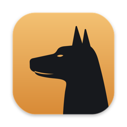
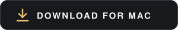
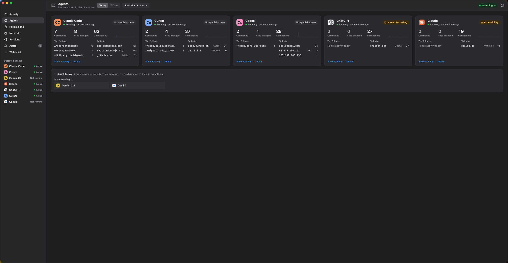
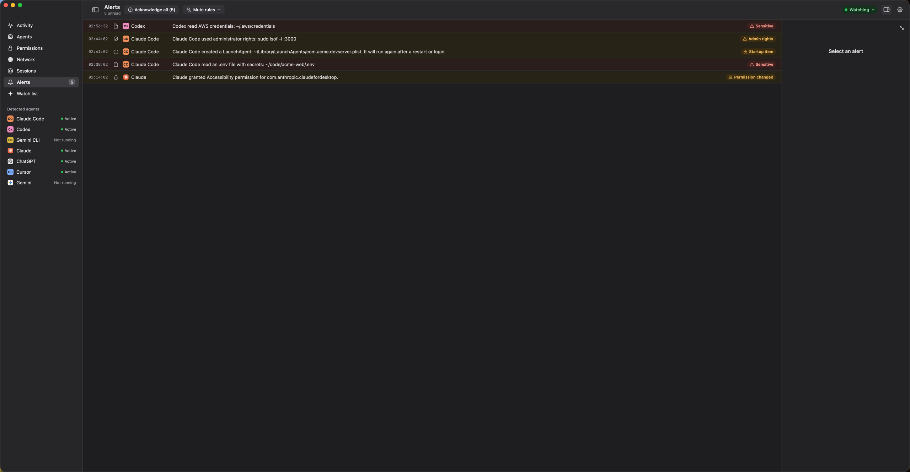

# Ranger

**See what your AI agents actually do on your Mac.** 
Every command they run, file they read or change, place they connect to and permission they hold, 
attributed to the agent that did it and explained in plain English.

macOS 14 or later · Apple silicon · signed and notarized · alpha

 

Screenshots use made-up demo data.

## Why

AI agents like Claude Code, Codex, Cursor and ChatGPT run commands, edit files and talk to the
internet on their own, often with broad permissions such as Full Disk Access, Accessibility or
Screen Recording. Ranger shows you what they did with that access. It only watches: it never
blocks, changes or uploads anything.

## What you get

- **Activity.** A live, plain-English feed: *"Claude Code ran `git push origin main`"*,
  *"Cursor modified 3 files in `~/code/app/src/api`"*. Filter by agent, type, severity and action,
  and open any line to see the process tree, files and connections behind it.
- **Agents.** What each agent did today or this week: commands, files changed, connections, the
  folders it worked in and who it talked to.
- **Alerts.** Credential reads and copies, new startup items, administrator rights, code
  injection, kernel extensions and permission changes. Repeats fold into one row, and anything
  can be muted.
- **Permissions.** Which privacy permissions each agent and terminal holds, in plain English,
  with when Ranger first saw each one and how it changed.
- **Network.** Every destination, grouped by the network that owns it, with unusual ports and
  unknown owners called out.
- **Your rules.** Watch any app or command-line tool, choose which macOS events to record, and
  mute the noise you never want to see.

## Install

1. [Download the DMG](https://github.com/0xVulcan/Ranger/releases/download/v0.7.0-alpha.1/Ranger-0.7.0-alpha.1.dmg),
   open it and drag **Ranger** to **Applications**.
2. Open Ranger and follow the two prompts: allow it **in the background**, then give its helper
   **Full Disk Access**. Ranger walks you through both.
3. Click the menu bar icon for a quick look, or **Open Ranger** for everything.

The DMG includes a *Read me first* with details, troubleshooting and how to uninstall.

## Private by design

- Everything stays on your Mac. Nothing is uploaded, and there is no account.
- Ranger records only what watched agents and the programs they start do, not everything
  on your Mac.
- History is kept for 30 days by default, with an optional size limit, and can be cleared at
  any time.

## Status

This is an early alpha. Expect rough edges.
[Open an issue](https://github.com/0xVulcan/Ranger/issues) for bugs, questions or ideas.

The source code is not public yet.
